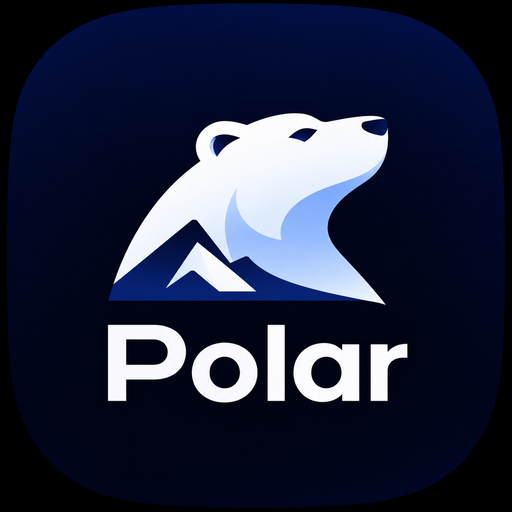

# Polar

Polar is a fork of [Banana Native](https://github.com/moceure/BananaNative), based on [nxnative](https://github.com/seedds/nxnative).

It runs Switch and Switch 2 games on Android phones from your own console dumps. Like Wine, it does not emulate hardware: the game's ARM64 code runs natively on the phone's CPU while Polar handles Horizon OS system services and translates NVN graphics to Vulkan (with ahead-of-time shader translation to SPIR-V).

> [!NOTE]
> Unofficial and experimental. This repository contains no Nintendo code, firmware, or keys, and does not decrypt anything. Use only dumps of games you own.

## Requirements

- Android 13+ phone with a Snapdragon (Adreno) GPU; Android 12/12L works with the experimental Android 12 build
- Your own game dump (`base/`, `updates/<version>/`, `dlc/`, or a `.nup` package)

## Setup

1. Install the Android APK (package name `dev.polar.android`) and grant **All files access**.
2. Prepare a game pack on PC/Mac (`scripts/polar.bat` or `scripts/polar.command`) or directly on the phone via **Add game** → **Prepare**.
3. Launch the game from the app.

## Games

The [games table](../dm/games/README.md#games) lists every title the app knows and links to its note. Each note says what was tested and what is still open; check your game's note for known problems before filming a video.

## Licence and credits

- Android build & internals: [android/README.md](../android/README.md)
- Player guides: [docs/guides/getting-started.md](../docs/guides/getting-started.md) · [docs/guides/troubleshooting.md](../docs/guides/troubleshooting.md)
- Built on [Banana Native](https://github.com/moceure/BananaNative) and [nxnative](https://github.com/seedds/nxnative) by seedds (MIT). The Android app is **GPL-3.0-or-later** as a whole ([android/NOTICE.md](../android/NOTICE.md)).
